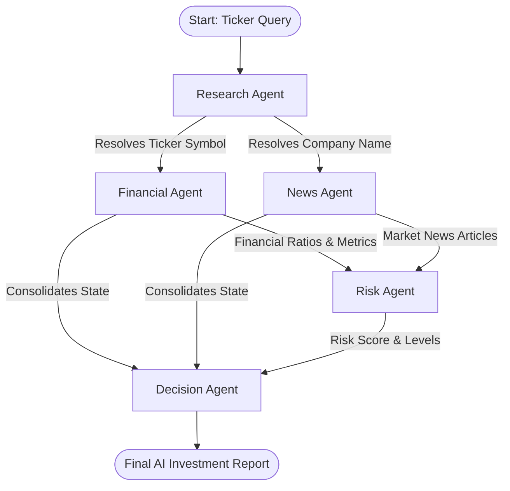

# AI Investment Research Agent

An AI-powered multi-agent investment research platform built using **Next.js**, **TypeScript**, **LangGraph**, **Prisma ORM**, and **Yahoo Finance**.

This platform automates equity research by executing a state-graph pipeline of specialized AI agents to gather data, analyze news, compute risks, and output structured investment recommendations alongside interactive charts.

---

## 🚀 Key Features

- **✅ LangGraph State-Graph Workflow**: Implements a real, stateful agent graph where specialised agents communicate with each other by writing and reading a shared state.
- **📈 Step 1: Historical Line Chart**: Fully interactive area line chart supporting multiple timeframes (`1D`, `5D`, `1M`, `3M`, `6M`, `1Y`, `5Y`) powered by ApexCharts.
- **🕯️ Step 2: Professional Candlestick Chart**: Shows detailed Open, High, Low, Close (OHLC) candles with color indicators (green/red) and volume bar charts.
- **🤖 Step 3: Multi-Agent Analysis Pipeline**:
  - **Research Agent**: Resolves stock search queries into ticker symbols and exchange metadata.
  - **Financial Agent**: Fetches company statistics, PE ratio, 52-week margins, market cap, and eps.
  - **News Agent**: Gathers up-to-date market news articles for sentiment evaluation.
  - **Risk Agent**: Computes a deterministic investment risk score based on volatility, metrics, and news frequency.
  - **Decision Agent**: Consumes all previous outputs to compile structured recommendations (BUY/SELL/HOLD, summary, pros, cons, and future outlook) via the Groq SDK.
- **✨ Premium UI/UX Dashboard**: Polished dark-mode UI with dynamic focus indicators, smooth transitions, instant range fetching, and responsive layouts.

---

## 🛠️ Tech Stack & Languages

- **Programming Languages**: TypeScript, JavaScript, SQL (for migrations)
- **Framework & Runtime**: Next.js (App Router), React, Node.js
- **Styling**: Tailwind CSS
- **Database & ORM**: SQLite, Prisma ORM
- **Charting Library**: ApexCharts, React-ApexCharts
- **Market Data Feed**: Yahoo Finance API (via `yahoo-finance2`)
- **LLM SDK**: Groq SDK (running Llama 3.3 70B model)

---

## 🔄 How It Works (Agent Architecture)

The backend utilizes a state-graph execution engine mimicking **LangGraph**:



1. **State Initialization**: The graph is invoked with `companyQuery` (e.g. "Apple") and `exchange`.
2. **Research Node**: Searches Yahoo Finance for the ticker, picks the best match, and updates state with `companyInfo`.
3. **Financial & News Nodes (Parallel)**:
   - Financial Agent queries the real-time quote for the symbol.
   - News Agent pulls recent articles based on the resolved company name.
4. **Risk Node**: Calculates the risk level by evaluating PE metrics, price change percent, and adjusting the score based on the volume of news articles gathered (inter-agent consumption).
5. **Decision Node**: Invokes Groq to analyze the consolidated state (overview, financial metrics, news, risk profile) to write the final advice, summary, pros, cons, and future outlook.

---

## 📦 Installation & Setup

### Prerequisites

- Node.js (v18.x or above)
- npm or yarn

### 1. Clone & Install Dependencies

```bash
git clone https://github.com/Srujanaaddanki/AI-Investment-Research-Agent.git
cd AI-Investment-Research-Agent/ai-investment-agent
npm install
```

### 2. Configure Environment Variables

Create a `.env.local` file in the `ai-investment-agent` root directory:

```env
GROQ_API_KEY=your_groq_api_key
NEWS_API_KEY=your_news_api_key
DATABASE_URL="file:./dev.db"
```

Configure your `.env` file as well:

```env
DATABASE_URL="file:./dev.db"
```

### 3. Setup Database Schema

Push the Prisma database schema and generate the client:

```bash
npx prisma generate
npx prisma db push
```

### 4. Run the Development Server

```bash
npm run dev
```

Open [http://localhost:3000](http://localhost:3000) in your browser to start searching stocks.

---

## 📈 Benefits

1. **Data-Backed Insights**: Blends hard financial ratios with recent market sentiment news in a unified decision framework.
2. **No LLM Hallucinations on Numbers**: Crucial figures (P/E, Market Cap, Change) are queried directly from market feeds rather than guessed by LLMs.
3. **Optimized Operations**: Lightweight graph architecture fetches sub-intervals on demand, preventing redundant expensive LLM pipelines.
4. **Intuitive Visualization**: Interactive candlestick and line charts let you visually inspect historical price trends alongside agent reasoning.
